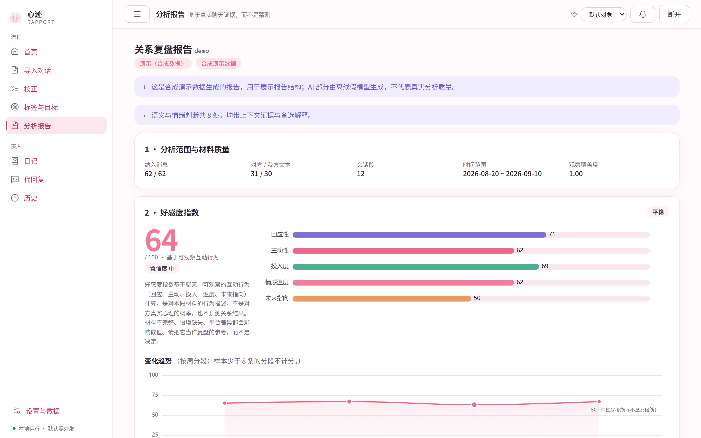
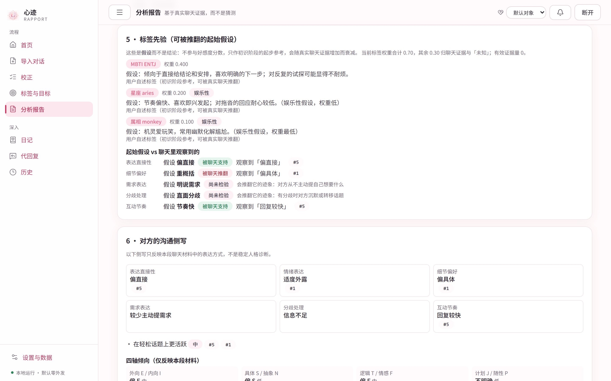

<div align="center">
  
  <h1>Rapport · 心迹</h1>
  <p><b>Turn a conversation into judgements you can see the evidence for.</b></p>
  <p><sub>Open source · local-first · nothing uploaded, nothing guessed, no promises about outcomes</sub></p>

  [](LICENSE)
  
  
  
  
</div>

---

**[中文](README.md) · [English](README.en.md)**

---

## Why we built this

The hard part of a relationship is rarely finding something to say. It is the **guess you cannot check**.

Whether that "whatever" meant indifference or disappointment. Why someone warm last week is answering half a beat slower this week. We reread old conversations looking for an answer, and all too often find the version we were most afraid of — because memory picks its evidence and mood writes the conclusion.

Rapport does one modest thing: **it makes that rereading accountable.**

It turns a chat log into a set of observable, traceable, refutable judgements. Every claim points back to the messages that produced it; every inference states how uncertain it is: why the score is what it is, why a sentence reads as lukewarm, and when a suggestion should be dropped. It does not read minds, decide for you, or promise an outcome. It arranges material you already have into a shape you can actually examine.

We also believe this **material is too private to leave your computer**. Rapport defaults to zero outbound traffic: rules and local models run on your own machine. If you choose a cloud model, it first redacts the text, then shows you exactly what would be sent before anything leaves.

And we take one more thing seriously: **honesty**. The evaluation protocol, the measured numbers, the experiments that failed their gate and the known limits are all in the repository, including the results we would rather not have. We would rather write "this did not pass" than dress a hypothesis up as a capability.

---

## What it does

- **Affinity index and trend** — five observable dimensions (responsiveness, initiative, investment, warmth, future orientation) on a 0–100 scale, bucketed over time; every point opens onto the rule inputs, model judgements and evidence behind it.
- **Sentence-level intent and emotion** — context-aware readings with alternative interpretations, the number of independent fragments supporting each negative call, and the model's own evidence strength.
- **Playbook** — situation → concrete options → expected reactions → **stop condition** → risk, with example wording and three tones of template. Goals the other person already declined are not recommended again; landmines state their reason and source.
- **Communication profile** — expression tendencies and E/I · S/N · T/F · J/P leanings inferred from chat behaviour, compared against a self-reported MBTI (a test of an assumption, not a personality diagnosis).
- **MBTI / zodiac / Chinese zodiac: start from a hypothesis, not a verdict** — all three are optional, none of them changes the score, and none is ever sent to a model. Their job is to give the earliest stage, when there is little material, a starting point: each of the 16 MBTI types carries 3–6 hypothesis cards ("ENTJ: tends to give conclusions and arrangements; may grow impatient with repeated probing") at weight 0.40, zodiac signs work through their four elements at 0.20, Chinese zodiac at 0.10, and the remaining 0.30 is explicitly reserved for *unknown*. The weight decays with real evidence, α = 0.70·e^(−N/40): the more you talk, the lighter the label. The report then checks each hypothesis against what the chat actually shows — **supported / contradicted / untested** — with the evidence ids attached. Zodiac and Chinese zodiac are declared entertainment: lowest weight, no hypothesis cards, just a short pairing blurb.
- **Boundary and safety signals** — if the last 30 days of material contain a request to stop contact, a safety concern or an explicit refusal, the report opens with a prominent, evidence-linked notice. The score is still shown (v0.8 removed every scoring gate) and advancing suggestions carry a caution.
- **Diary memory and reply drafts** — optional, per-relationship, per-entry, local-only. Drafts cite the diary ids and versions they used; any draft that echoes unauthorised content is dropped by a fabrication check. **This tool never sends a message for you.**

<p align="center">
  
  
</p>

## Modes

| Mode | Needs | Gives | Where the data goes |
|---|---|---|---|
| **Demo** | nothing | full report structure on synthetic data | nowhere |
| **Rules** | nothing | five-dimension index, trend, stage, boundary, invitation chains, rule-based situations | nowhere |
| **Local AI** | [Ollama](https://ollama.com/download) on the same machine; no API key | the full BYOK feature set on your own GPU/CPU | **never leaves the machine** |
| **BYOK AI** | your own key (DeepSeek / Qwen / Moonshot / OpenAI / MiMo presets, or any OpenAI-compatible endpoint) | evidence-backed observations, persona, personalised playbook | only after you **preview** the redacted payload, destination and cost estimate and confirm |

MBTI / zodiac / Chinese zodiac are optional, never enter the core analysis and are never sent to the model.

## Quick start

Python 3.12+ and [uv](https://docs.astral.sh/uv/); Node 22+ to build the frontend from source.

```bash
git clone https://github.com/1hb6s7t/rapport.git && cd rapport
cd frontend && npm ci && npm run build && cd ..
cd backend && uv sync --extra ocr && uv run rapport serve
```

Open `http://127.0.0.1:7860` and enter the 6-digit pairing code printed in the terminal. Or `docker compose up --build` (the port is bound to host loopback only; find the code in `docker compose logs rapport`).

CLI, all offline: `uv run rapport analyze chat.txt` · `uv run rapport demo` · `uv run rapport doctor`.

Local models: `uv run rapport models doctor` · `models pull --profile solo` · `models local-on --profile solo`. Three profiles (`solo` 8B, `split` 4B+8B, `lite` 4B) differ only in which model answers which task. The settings page is the graphical equivalent. Local quality is still being measured — the numbers, including the ones that fell short, are in [docs/EVAL.md](docs/EVAL.md) §16.

## What a report looks like

Fixed order: scope and quality → affinity index (total / five dimensions / trend) → sentence-level intent and emotion → observations and counter-evidence → communication profile → stage and boundaries → playbook (actions / landmines / wording) → entertainment extras (collapsed) → version and cost.

```bash
uv run rapport demo        # the synthetic demo report, as Markdown
```

The weights, anchors and thresholds of scoring protocol `affinity-rubric-v0.1` sit at the top of [`backend/rapport/scoring/rubric.py`](backend/rapport/scoring/rubric.py), each one labelled a product hypothesis awaiting validation. The rules side and the AI side each produce a 0-100, fused half and half; the total is recomputed locally and any total the model returns is ignored. How rules mode actually computes is written out item by item in [docs/RULES.md](docs/RULES.md).

## Supported inputs

A/B paste template · WhatsApp `.txt` (iOS & Android line formats, ambiguous day/month must be chosen) · QQ message-manager `.txt` · WeChat third-party exports (`.csv` row lists and nested `session` + `messages` `.json`), plus an optional local WeChat database reader (opt-in, Windows, runs entirely on this machine — see docs/WECHAT-DATABASE.md) · Telegram Desktop single-chat `result.json` · screenshots (optional local RapidOCR, `uv sync --extra ocr`) · message-v1 JSON. Limit: 300 MiB / 50,000 rows, stated up front rather than truncated silently.

## Privacy & security

Loopback only; pairing code + HttpOnly session + CSRF header + Host/Origin allow-list. Raw chats are Fernet-encrypted under `~/.rapport/blobs/` and purged 24 h after analysis. Keys come from `RAPPORT_API_KEY` or an encrypted local file and never reach the frontend, logs or exports. Before a BYOK call, names become A/B and phone/ID/email/URL/card/address patterns are masked; you can edit the payload; confirmation is bound to a content hash. The model has no tools. See [SECURITY.md](SECURITY.md).

## Known limits

Rapport is **alpha, not beta**. The affinity index describes observable interaction behaviour — it is not a probability of how someone feels and it does not predict outcomes. Intent and emotion readings are wrong a noticeable fraction of the time, especially on sarcasm, playful anger and indirect refusal. Gold labels are currently written by the author alone, so every number is comparable across changes but is **not** an accuracy claim. Every parameter is an unvalidated product hypothesis. The full list, with measured values, is in [docs/LIMITATIONS.md](docs/LIMITATIONS.md).

## Development

```bash
cd backend && uv sync --extra ocr && uv run pytest -q && uv run ruff check rapport tests ../scripts
cd frontend && npm ci && npx tsc --noEmit && npx vitest run && npm run build
```

Scoring weights and anchors live at the top of `backend/rapport/scoring/rubric.py`, each labelled as a product hypothesis; how the rules mode actually computes is written out in [docs/RULES.md](docs/RULES.md). Contracts: `backend/rapport/schemas/` (message-v1, report-v1). Prompts: `backend/rapport/llm/prompts/`. Architecture and extension points: [docs/ARCHITECTURE.md](docs/ARCHITECTURE.md).

## Docs map

| File | What to read it for |
|---|---|
| [docs/ARCHITECTURE.md](docs/ARCHITECTURE.md) | Layers, extension points, known debt |
| [docs/RULES.md](docs/RULES.md) | How rules mode actually computes (features -> anchors -> weights -> stage -> boundaries); every step an unvalidated hypothesis |
| [docs/EVAL.md](docs/EVAL.md) | Evaluation protocol and every historical number, including the experiments that failed |
| [docs/LIMITATIONS.md](docs/LIMITATIONS.md) | The honest capability limits |
| [docs/DRIVE.md](docs/DRIVE.md) | The three-state design behind proactive reminders |
| [docs/EMOTION-LAYER.md](docs/EMOTION-LAYER.md) | The offline emotion research layer: components, fusion rules, evaluation, limits |
| [docs/WECHAT-DATABASE.md](docs/WECHAT-DATABASE.md) | The optional WeChat database reader: scope, how it works, limits, compliance notes |
| [docs/TECH-PLAN-v2.md](docs/TECH-PLAN-v2.md) · [docs/ROADMAP.md](docs/ROADMAP.md) | Technical plan and roadmap |
| [CHANGELOG.md](CHANGELOG.md) | What changed in each release, and why |

## Out of scope

No auto-sending (the optional desktop paste needs a manual click per message); no accounts, payments, cloud sync, community or telemetry; no media downloads (the optional speech-to-text runs locally); no model training; no accuracy claims; not for minors; not a clinical or crisis tool. The optional WeChat database reader is off by default and runs only on this machine — see [docs/WECHAT-DATABASE.md](docs/WECHAT-DATABASE.md).

## Credits and sources

During product research we looked at public relationship-analysis products, and at published work on textual attraction cues, emotion recognition in dialogue, text-based personality computing and its limits, and emotional-support conversation strategies. All code, prompts, word lists, action templates and synthetic data in this project are original and MIT licensed. Third-party licences are listed in [THIRD_PARTY_NOTICES.md](THIRD_PARTY_NOTICES.md).
