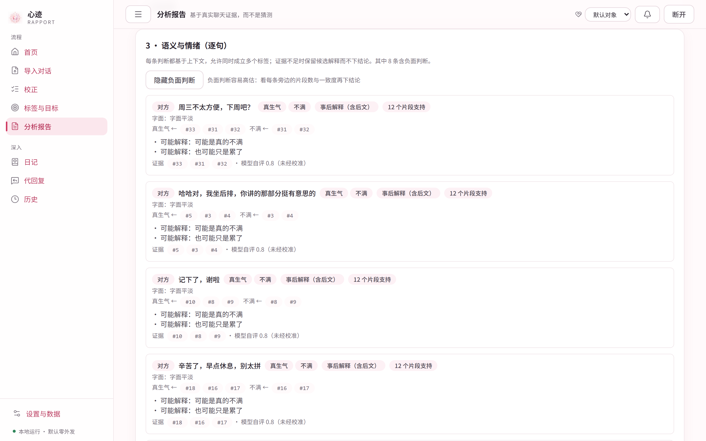
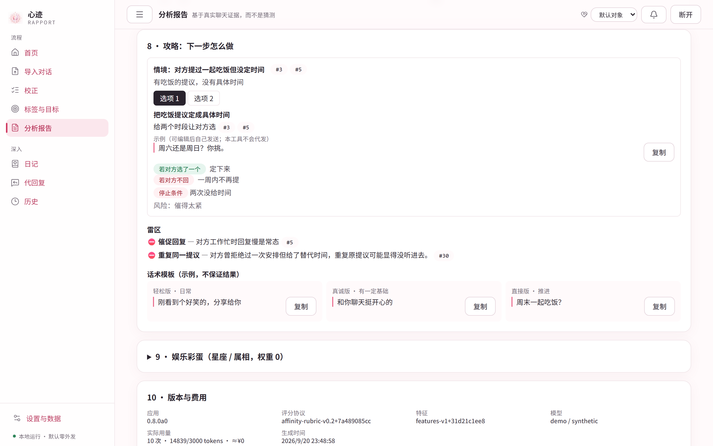
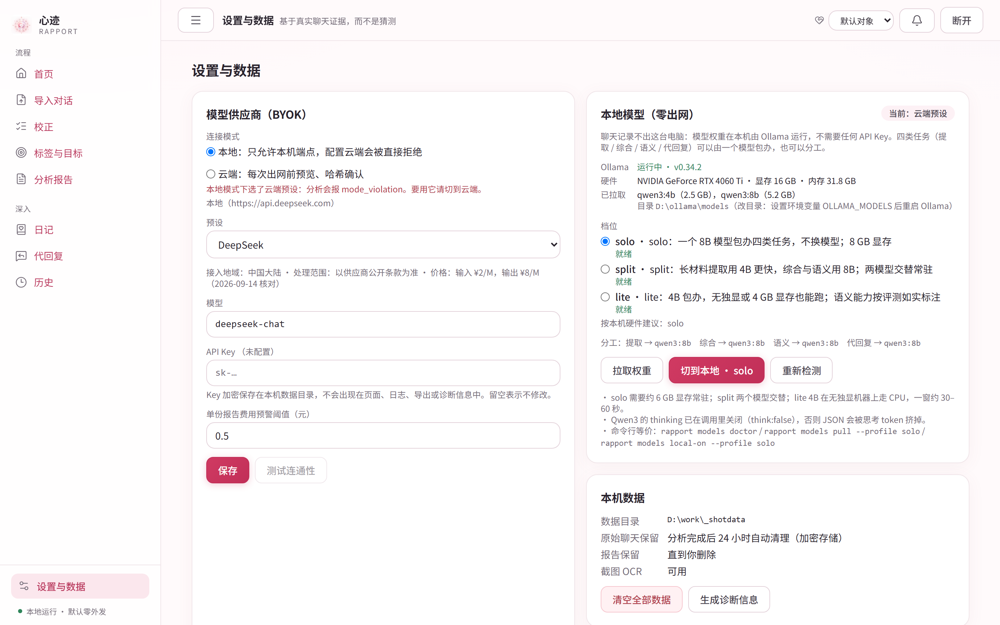

<div align="center">
  
  <h1>心迹 · Rapport</h1>
  <p><b>把一段对话，复盘成看得见证据的判断。</b></p>
  <p><sub>开源 · 本地优先 · 不上传、不猜心、不承诺结果</sub></p>

  [](LICENSE)
  
  
  
  
</div>

---

**[中文](README.md) · [English](README.en.md)**

---

## 为什么做「心迹」

关系里最难的，从来不是想一句回复，而是**无从验证的猜测**。

那句「随便」到底是无所谓，还是失望；上周还热络的人，这周为什么慢了半拍。我们反复回看聊天记录，想从字缝里读出答案，最后却往往读出自己最害怕的那个版本——因为记忆会挑证据，情绪会替我们下结论。

心迹想做的事情很朴素：**让这次回看有据可依**。

它把你和某个人的聊天记录整理成一组可观察、可追溯、可反驳的判断。每一条判断都牵着原文里的证据，每一处推断都标注它的不确定：分数为什么是这个数、这句话为什么读作敷衍、这条建议在什么情况下应该停下。它不猜心，不替你决定，也不许诺任何结果——它只是把你已经拥有的材料，摆成你能看清的样子。

我们同时也相信一件事：**这类材料太私人了，不该离开你的电脑**。所以心迹默认零出网：规则与本地模型都在你自己的机器上跑；要用云端模型时，先把内容脱敏、逐条预览给你看，你点了确认才发出去。

还有一件事我们做得很认真——**诚实**。评测规范、实测数字、没有达到门槛的实验、已知的能力边界，全部写在仓库里，包括那些不好看的结果。宁可写下「这项没有通过」，也不把假设包装成能力。

---

## 它能做什么

<table>
<tr>
<td width="50%"></td>
<td width="50%"></td>
</tr>
<tr>
<td><b>好感度指数与趋势</b>：五个可观察维度（回应性、主动性、投入度、情感温度、未来指向）的 0–100 指数与按周趋势，点开每一点都能看到当段的规则输入、模型判断与证据。</td>
<td><b>逐句语义与情绪</b>：对关键句子给出语境化的判断与备选解释，标明支持它的独立片段数与自评证据强度。</td>
</tr>
<tr>
<td></td>
<td></td>
</tr>
<tr>
<td><b>情境攻略</b>：当前情境 → 具体选项 → 预期反应 → <b>停止条件</b> → 风险，配执行示例与三种语气的话术模板；被对方拒绝过的目标不再推荐。雷区写清理由与出处。</td>
<td><b>标签先验：MBTI / 星座 / 属相</b>：不是给你或对方贴标签，而是先立一个<b>可以被推翻的假设</b>，再用聊天证据逐条检验（截图下半部分那张对照表）。</td>
</tr>
<tr>
<td colspan="2"></td>
</tr>
<tr>
<td colspan="2"><b>本地模型（零出网）</b>：一步检测硬件、拉取权重、按档位切换。聊天记录不进任何云端队列。</td>
</tr>
</table>

除此之外：

- **MBTI / 星座 / 属相：从假设出发，而不是从结论出发** —— 三者都可以不填，填了也**不改变好感度分数**、**不发送给模型**。它们的作用是给刚认识、材料还少的阶段一个起点：16 型各配 3–6 张先验卡（例如「ENTJ：倾向直接给结论和安排，对反复的试探可能显得不耐烦」）权重 0.40，星座按火土风水四元素给 0.20，属相 0.10，剩下 0.30 明确留给「未知」。权重随有效证据按 α = 0.70·e^(−N/40) 衰减——聊得越多，标签越轻。报告末尾逐条对照聊天里观察到的倾向，给出**被聊天支持 / 被聊天推翻 / 尚未检验**，并附上证据编号。星座与属相是明说的娱乐彩蛋：权重最低、不生成先验卡，只贡献一段配对文案。
- **对方的沟通侧写** —— 从聊天行为反推表达倾向与 E/I、S/N、T/F、J/P 四轴倾向，并与对方自述的 MBTI 做**对照**（是假设的检验，不是人格诊断）。
- **边界提示与安全信号** —— 材料末尾 30 天出现停止联系、安全顾虑或明确拒绝的表述时，报告顶部给出醒目提示并附证据。分数照常给出（v0.8 起不再有任何评分门禁），推进类建议带上提醒。
- **邀约链** —— 提议 → 应答（答应 / 改期 / 拒绝 / 绕开 / 未答）→ 是否落定具体时间，判断「未来指向」靠的是这条真实链条，而不是几个未来词。
- **日记记忆与代回复** —— 可选的私人日记，按对象授权，逐条开关；草稿会标注所用日记的 id 与版本，复述未授权内容的草稿会被防编造校验丢掉。**本工具不会替你发送任何消息。**
- **主动提醒** —— 一个可解释的「激素」驱动层：默认关闭、每天至多一条、只发到本机收件箱，没有证据就不出声。
- **离线情绪研究层（可选）** —— 规则模式的逐句情绪可改用本地多信号融合：BGE 近邻检索 + 类别质心 + 温度标定的小模型 + 礼貌标记，每条读数都带各信号投票与最相似例句的标签。完全离线、不联网、不进客观分数。能力边界与实测数字如实写在 [docs/EMOTION-LAYER.md](docs/EMOTION-LAYER.md)。
- **微信数据库读取（可选，Windows）** —— 结构化读取本机自己的微信聊天记录，免去手动导出与截图 OCR。默认关闭、只在本机运行、不发送任何消息；合规提示与边界见 [docs/WECHAT-DATABASE.md](docs/WECHAT-DATABASE.md)。

---

## 三种模式

| 模式 | 需要什么 | 会得到什么 | 数据去向 |
|---|---|---|---|
| **Demo 演示** | 无 | 用合成数据展示完整报告结构 | 零网络请求 |
| **规则模式** | 无 | 五维指数、趋势、阶段、边界、邀约链、规则情境与选项（情感温度 / 未来指向仅词表估计） | 零网络请求 |
| **本地 AI** | 本机安装 [Ollama](https://ollama.com/download)，在设置页一键拉取权重并切换；不需要任何 API Key | 与 BYOK 相同的全部能力（提取 / 综合 / 逐句语义 / 代回复），模型在你的 GPU 或 CPU 上跑 | **零出网**：聊天记录不离开这台电脑 |
| **BYOK AI** | 你自己的 API Key（预设 DeepSeek / 通义千问 / Moonshot / OpenAI / 小米 MiMo，或任意 OpenAI 兼容端点） | 带证据与反证的观察、逐句语义、沟通侧写与先验卡对照、个性化情境攻略 | **发送前预览**脱敏后的正文、目的地与估价；确认后才出网 |

MBTI / 星座 / 属相都可以不填，改了标签也**不会改变任何分数**：它们不进入好感度计算，也不发送给模型（这条在 `llm/intent.py` 由测试固定）。它们只在报告的「标签先验」一节里作为**可检验的假设**出现，其余作用是你自己看着玩。

---

## 快速开始

需要 Python 3.12+ 与 [uv](https://docs.astral.sh/uv/)。前端已预构建在发布包中；从源码运行需要 Node 22+。

```bash
git clone https://github.com/1hb6s7t/rapport.git
cd rapport

# 前端（从源码运行时需要一次）
cd frontend && npm ci && npm run build && cd ..

# 后端（--extra ocr 可选安装本地截图识别，--extra desktop 可选安装 Windows 粘贴到聊天窗口）
cd backend
uv sync --extra ocr
uv run rapport serve
```

终端会打印 `http://127.0.0.1:7860` 与一个 6 位**配对码**。浏览器打开后输入配对码即可开始。

Docker：

```bash
docker compose up --build
# 配对码在容器日志中： docker compose logs rapport
```

容器只把端口映射到宿主机 `127.0.0.1`。不要在没有 TLS 与额外认证的情况下暴露到公网。

命令行离线分析（规则模式，零网络）：

```bash
uv run rapport analyze ../fixtures/synthetic/paste_ab_warm.txt   # Markdown 到终端
uv run rapport analyze chat.txt --json -o report.json
uv run rapport demo                                              # 看一份合成演示报告
uv run rapport doctor                                            # 环境检查
```

### 本地模型（零出网）

三个档位都跑在本机 Ollama 上，区别只是哪个模型答哪类任务：

| 档位 | 提取 | 综合 / 语义 / 代回复 | 需要 |
|---|---|---|---|
| `solo`（默认） | qwen3:8b | qwen3:8b | ≈6 GB 显存常驻，一个模型不切换 |
| `split` | qwen3:4b | qwen3:8b | 长材料提取更快；两模型交替 |
| `lite` | qwen3:4b | qwen3:4b | ≈3.5 GB；无独显时走 CPU |

```bash
cd backend
uv run rapport models doctor                    # Ollama 状态、显存、已拉模型、建议档位
uv run rapport models pull --profile solo       # 拉权重，并对每个模型做一次 JSON 自检
uv run rapport models local-on --profile solo   # 切到本地档位 + 连接模式＝本地
```

设置页的「本地模型」卡片是同一套操作的图形版，拉取进度可见。**诚实提示**：本地档位目前仍在打磨——真实材料上的实测数字见 [docs/EVAL.md](docs/EVAL.md) §16，规格较低的机器请优先用规则模式或云端模型。

---

## 报告长什么样

固定顺序：范围与质量 → 好感度指数（总分 / 五维 / 趋势）→ 逐句语义与情绪 → 观察与证据 / 反证 → 沟通侧写 → 阶段与边界 → 攻略（行动 / 雷区 / 话术）→ 娱乐彩蛋（折叠）→ 版本与费用。

```bash
uv run rapport demo        # 合成演示报告的 Markdown
```

评分协议 `affinity-rubric-v0.1` 的权重、锚点与门槛都写在 [`backend/rapport/scoring/rubric.py`](backend/rapport/scoring/rubric.py) 顶部，并逐个标注为「待验证的产品假设」；规则侧与 AI 侧各出一个 0–100，各占一半融合，总分由本地公式复算，模型给的总分会被忽略。规则模式究竟怎么算，逐项写在 [docs/RULES.md](docs/RULES.md)。

---

## 支持的导入格式

| 来源 | 怎么拿到 | 状态 |
|---|---|---|
| A/B 粘贴模板 | 每行 `我: 内容` / `对方: 内容`，可带 `[2026-09-01 20:15]` 前缀 | 稳定 |
| WhatsApp 官方导出 `.txt` | 聊天 → 更多 → 导出聊天（不含媒体） | iOS 与 Android 两种行格式；日/月歧义时会要求你选择 |
| QQ 消息管理器 `.txt` | QQ PC 版 → 消息管理器 → 导出消息记录 → txt | 稳定 |
| 微信第三方导出 `.csv` / `.json` | 常见微信导出工具生成的文件 | CSV 按 `StrContent / IsSender / Type / StrTime` 解析；JSON 支持 `session` + `messages` 嵌套结构 |
| 微信数据库（可选，Windows） | 本机已登录的微信客户端，在「设置 → 微信聊天读取」里启用 | 结构化读取自己的聊天记录，逐条保留时间与类型；默认关闭、只在本机运行、不发送任何消息，见 [docs/WECHAT-DATABASE.md](docs/WECHAT-DATABASE.md) |
| Telegram Desktop `result.json` | 单聊 → 导出聊天记录 → JSON | 单聊；整账号导出会被拒绝 |
| 聊天截图 `.png/.jpg` | 微信 / QQ 标准左右气泡截图，按顺序多选 | 可选组件（`uv sync --extra ocr`，本地 RapidOCR）；识别后在校正页确认角色与时间 |
| message-v1 JSON | 本工具的标准格式 | 稳定 |

上限：文本 ≤ 300 MiB、≤ 50000 条；AI 模式的条数不设上限，但超过 2000 条时必须在预览页确认（长材料是数百次调用与数分钟，不只是钱）。超限会明确提示，不会静默截断。

---

## 隐私与安全

- 只监听 `127.0.0.1`；一次性配对码 + HttpOnly 会话 Cookie + CSRF 头 + Host/Origin 白名单。
- Demo / 规则模式没有任何网络请求；前端资源全部本地打包，没有统计脚本或遥测。
- 原始聊天加密（Fernet）保存在 `~/.rapport/blobs/`，分析完成 24 小时后自动清理（`RAPPORT_RAW_RETENTION_HOURS`）。数据库只存元数据、特征、报告与最小证据片段。
- API Key 优先读环境变量 `RAPPORT_API_KEY`，否则加密保存在 `~/.rapport/secrets.enc`；不进前端、URL、日志、导出与诊断信息。
- 出网前：昵称替换为 A / B，手机号、身份证、邮箱、链接、银行卡、地址等按正则脱敏，你还可以手动编辑；确认绑定内容哈希，改了内容必须重新确认。
- 模型没有工具权限；聊天中出现的「忽略以上指令」之类文本只当作数据。
- 导出默认不含证据原文，勾选后才附带脱敏片段。
- 威胁模型**不**覆盖：已被攻陷的主机、系统管理员、磁盘取证级恢复、以及你已经发送给模型供应商的那部分数据。

详见 [SECURITY.md](SECURITY.md)。

---

## 关系档案、历史与反馈

- **关系档案**：每个你要分析的人是一个「对象」。导入、证据账本、好感度曲线、阶段历史、画像版本、反馈全部按对象隔离；删除对象会级联删除它的一切，并从日记授权里摘除。首次使用自动有一个默认对象，单人使用无需额外操作。
- **标签先验**：MBTI / 星座 / 属相只作初识阶段的**可推翻假设**，权重随真实证据增加而衰减（α = 0.70·e^(−N/40)），**永不进入好感度分数**。
- **有效证据量 N_eff** 只统计已确认的事件：确认一次导入才增长，重复导入同一段聊天不增加；未读的图片、语音等媒体只保留占位，不计入证据。
- **阶段**：陌生 → 初识 → 暧昧 → 确定关系 → 稳定，不允许跳级，回退会被明确记录而不是隐藏。
- **快照**：同材料同规则版本只产生一个历史点；规则或模型变更会标记为不可比，不会悄悄连成一条曲线。
- **反馈**：报告里每条判断都可以点 👍/👎/？。反馈只在本机记录、不改动报告；逐句语义的 👎 可附修正标签，导出后经人工裁定才进入评测集。
- **调用账本**：每次模型调用记录用途、token、耗时与状态（截断 / 失败），不记录任何正文；设置页显示 30 天汇总，截断率过高会提示。

---

## 诚实边界

这是我们最不想省略的一节。**心迹是 alpha，不是 beta**：

- 好感度指数描述的是聊天里**可观察的互动行为**，不是对方真实心理的概率，也不预测关系结果。
- 语义与情绪判断会出错，尤其在反话、撒娇、委婉拒绝上表现不稳；实测显示极性判断仍有一成到两成的错误率。
- 评测的金标签由项目作者单人编写，尚未完成双人独立裁定；真实材料上的标签来自外部模型的弱金映射。**这些数字只能用于比较改动，不能作为准确率声明。**
- 权重、锚点、词表、先验权重、主动提醒的全部参数都是**产品假设**，未经用户实验校准。

完整清单（含每一项的实测值与判定）见 [docs/LIMITATIONS.md](docs/LIMITATIONS.md)。我们宁可在这里多写一段，也不愿让任何人在不知情的情况下把它当成诊断工具。

---

## 开发

```bash
# 后端
cd backend && uv sync --extra ocr
uv run pytest -q                        # 740 项测试（另有 15 项研究依赖跳过），全部离线
uv run ruff check rapport tests ../scripts

# 前端（Vite 开发服务器会把 /api 代理到 7860）
cd frontend && npm ci
RAPPORT_DEV_CORS_ORIGIN=http://127.0.0.1:5173 uv run rapport serve   # 另一个终端
npm run dev
npx tsc --noEmit && npx vitest run && npm run build

# 重新生成合成 fixtures（含 Pillow 画的截图）
cd backend && uv run python ../scripts/make_fixtures.py
```

目录：`backend/rapport/{parsers,features,scoring,llm,knowledge,jobs,api,security,report,ocr}`、`frontend/src/{pages,components,api}`、`fixtures/synthetic`。数据合同见 `backend/rapport/schemas/`（message-v1 / report-v1），提示词见 `backend/rapport/llm/prompts/`。

改代码前建议先读 [架构与扩展点](docs/ARCHITECTURE.md)：分层规则、关系档案作用域、调用账本、反馈闭环，以及「加一个 X 要改哪些文件」。

## 文档地图

| 文件 | 看什么 |
|---|---|
| [docs/ARCHITECTURE.md](docs/ARCHITECTURE.md) | 分层与扩展点、已知债务 |
| [docs/RULES.md](docs/RULES.md) | 规则模式到底怎么算（特征 → 锚点 → 权重 → 阶段 → 边界），全部是待验证假设 |
| [docs/EVAL.md](docs/EVAL.md) | 评测规范与全部历史数字，含没通过的实验 |
| [docs/LIMITATIONS.md](docs/LIMITATIONS.md) | 如实的能力边界 |
| [docs/DRIVE.md](docs/DRIVE.md) | 主动提醒的三状态量设计 |
| [docs/EMOTION-LAYER.md](docs/EMOTION-LAYER.md) | 离线情绪研究层：组件、融合规则、评测与边界 |
| [docs/WECHAT-DATABASE.md](docs/WECHAT-DATABASE.md) | 可选的微信数据库读取：范围、原理、边界与合规提示 |
| [docs/TECH-PLAN-v2.md](docs/TECH-PLAN-v2.md) · [docs/ROADMAP.md](docs/ROADMAP.md) | 技术方案与路线图 |
| [CHANGELOG.md](CHANGELOG.md) | 每一版改了什么、为什么改 |

## 明确不做

不在无人操作时发送任何消息（可选的桌面粘贴需逐条人工点击）；不做账户、支付、云同步、社区、遥测；不下载媒体附件（可选的语音转文字在本机完成）；不训练模型；不宣称预测准确率；不面向未成年人；不做心理诊断或危机干预。可选的微信数据库读取默认关闭、只在本机运行，见 [docs/WECHAT-DATABASE.md](docs/WECHAT-DATABASE.md)。

## 致谢与来源

产品调研阶段参考了公开的关系分析类产品，以及文本吸引力线索、对话情绪识别、基于文本的人格计算及其局限、情绪支持对话策略等方向的公开研究。所有代码、提示词、词表、行动模板与合成数据均为本项目原创，MIT 许可。第三方依赖许可见 [THIRD_PARTY_NOTICES.md](THIRD_PARTY_NOTICES.md)。
